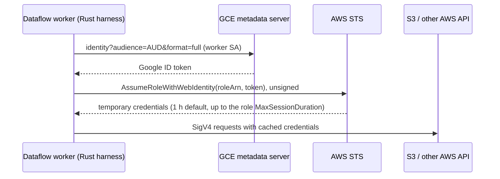

<!--
    Licensed to the Apache Software Foundation (ASF) under one
    or more contributor license agreements.  See the NOTICE file
    distributed with this work for additional information
    regarding copyright ownership.  The ASF licenses this file
    to you under the Apache License, Version 2.0 (the
    "License"); you may not use this file except in compliance
    with the License.  You may obtain a copy of the License at

      http://www.apache.org/licenses/LICENSE-2.0

    Unless required by applicable law or agreed to in writing,
    software distributed under the License is distributed on an
    "AS IS" BASIS, WITHOUT WARRANTIES OR CONDITIONS OF ANY
    KIND, either express or implied.  See the License for the
    specific language governing permissions and limitations
    under the License.
-->

# AWS Workload Authentication

**Status:** draft. This design is not implemented.

This document proposes how Rust pipelines authenticate to AWS. The first target is Dataflow.
Dataflow workers get AWS credentials through GCP → AWS identity federation, so the job holds
no long-lived AWS secret. For the support in other SDKs, see
[sdk-parity.md](sdk-parity.md#aws-credentials).

All work follows the [guiding principles](rfc-followups.md#guiding-principles) and
[development.md](development.md).

---

## 1. Building blocks

### 1.1 In this SDK

- [`PipelineOptionGroup`](../beam/core/src/options/groups.rs): clap parses a group on the
  driver, and serde sends it to the workers. Groups register through `inventory`.
- [`Secret`](../beam/core/src/options/secret.rs): a reference such as `env:`, `file:` or
  `gcp:`. It cannot hold plaintext.
- [`FileSystemRegistration`](../beam/io/file/src/filesystem.rs): the scheme registry. Its
  factory is `fn() -> Arc<dyn FileSystem>`, so a file system gets no options.
- `google-cloud-auth` is a dependency. Its `idtoken` feature is off by default. It gets Google
  ID tokens through Application Default Credentials (ADC): `idtoken::Builder::new(audience)`.

### 1.2 In the AWS Rust SDK

| Item | Crate / type | Use |
|---|---|---|
| Credential types | `aws-credential-types`: `Credentials` (with `expiry`), `ProvideCredentials`, `SharedCredentialsProvider` | Use as is |
| Default chain, profile, IMDS, ECS | `aws-config` | Use as is |
| AssumeRole | `aws_config::sts::AssumeRoleProvider` | Use as is |
| Web identity | `aws_config::web_identity_token::WebIdentityTokenCredentialsProvider` reads the token only from a file (`AWS_WEB_IDENTITY_TOKEN_FILE`) | Not enough. Federation needs a fetch that gets a Google ID token |
| Identity cache | `aws-smithy-runtime` `IdentityCache::lazy()`: `buffer_time` (10 s by default, times a random jitter of 0–0.5), `load_timeout`, `default_expiration` | Lazy refresh only. See §2.4 |

---

## 2. Design

### 2.1 Crate layout

- Add the crate `apache-beam-io-aws` at `beam/io/aws`. Put it behind the facade features `aws`
  and `s3`, as `gcp` and `gcs` are.
- Dependencies: `aws-config`, `aws-credential-types`, `aws-sdk-sts`, and later `aws-sdk-s3`.
  Federation also needs `google-cloud-auth` with `features = ["idtoken"]`.
- Vet each new dependency before you add it.

### 2.2 Options: credentials as data

Credentials are one algebraic data type. No variant holds plaintext: each secret value is a
[`Secret`](../beam/core/src/options/secret.rs) reference.

```rust
#[derive(Args, Debug, Clone, PartialEq, Eq, Default, Serialize, Deserialize)]
pub struct AwsOptions {
    /// AWS region, such as `us-east-1`.
    #[arg(long)]
    pub aws_region: Option<String>,

    /// Endpoint override, for example for LocalStack.
    #[arg(long)]
    pub aws_endpoint: Option<String>,

    /// Where workers get AWS credentials.
    #[arg(long, default_value = "default")]
    pub aws_credentials: AwsCredentials,

    /// Seconds before expiry when the identity cache loads new credentials.
    #[arg(long, default_value_t = 10)]
    pub aws_credentials_refresh_buffer_secs: u64,
}

#[derive(Debug, Clone, PartialEq, Eq, Default, Serialize, Deserialize)]
#[serde(tag = "@type")]
pub enum AwsCredentials {
    /// The AWS default chain: environment, profile, web-identity file, ECS, IMDS.
    #[default]
    #[serde(rename = "DefaultCredentialsProvider")]
    Default,
    /// Unsigned requests, for public buckets.
    #[serde(rename = "AnonymousCredentialsProvider")]
    Anonymous,
    #[serde(rename = "ProfileCredentialsProvider")]
    Profile { profile_name: Option<String> },
    #[serde(rename = "StaticCredentialsProvider")]
    Static {
        access_key_id: Secret,
        secret_access_key: Secret,
        session_token: Option<Secret>,
    },
    #[serde(rename = "StsAssumeRoleCredentialsProvider")]
    AssumeRole {
        role_arn: String,
        external_id: Option<String>,
        duration_seconds: Option<u32>,
        source: Box<AwsCredentials>,
    },
    /// A Google ID token, exchanged through STS `AssumeRoleWithWebIdentity`.
    #[serde(rename = "StsAssumeRoleForFederatedCredentialsProvider")]
    Federated {
        role_arn: String,
        audience: String,
        duration_seconds: Option<u32>,
        token_source: WebIdentityTokenSource,
    },
}

#[derive(Debug, Clone, PartialEq, Eq, Serialize, Deserialize)]
pub enum WebIdentityTokenSource {
    /// Google ADC: the metadata server on Dataflow and GKE, impersonation on a workstation.
    GoogleAdc,
    /// A token that is read from a `Secret` at each refresh.
    Secret(Secret),
}
```

- The `@type` names are the names that the Java expansion decodes (§2.7).
- `AssumeRole.source` names the credentials that call STS, so role chains are explicit.

### 2.3 Resolution: a pure function and a shared provider

```rust
impl AwsCredentials {
    /// Builds a provider from data, with no global state.
    pub fn provider(&self, region: &Region) -> SharedCredentialsProvider { ... }
}

/// Returns the worker-wide provider for these options. All `DoFn`s and the S3 file system share it.
pub fn shared_provider(options: &AwsOptions) -> SharedCredentialsProvider { ... }
```

- `Default`, `Anonymous`, `Profile` and `AssumeRole` map to `aws-config` providers.
- `Federated` uses a small fetch function. It gets an ID token from `token_source`, then calls
  `AssumeRoleWithWebIdentity` with an unsigned STS client. The session name is
  `beam-<job>-<worker>-<n>`. The returned `Credentials` get their `expiry` from STS.
- The worker keeps one provider for each `(credentials, region)` pair. So the STS call rate does
  not grow with the number of `DoFn` instances.

### 2.4 Refresh

The first version uses the lazy identity cache of the AWS SDK.

- A request uses the cached credentials if they are valid and outside the refresh buffer.
- In the buffer, after expiry, or on the first call, the request waits for new credentials.
  Then it is signed with them. Concurrent requests wait for the same load.
- So user code sees a short delay for the metadata server and STS calls. A request does not
  fail first and then start a refresh.
- **Limit:** if the load fails after the SDK retries, the request fails. The runner then retries
  the bundle. With default settings, the SDK retries for up to about 22 s. Confirm this failure
  behavior in the cache source during M1.
- `--aws_credentials_refresh_buffer_secs` sets how early the load starts. A large value, such as 300,
  gives a failed load time to succeed on a later request.
- Code gets credentials only through `shared_provider()`. So an eager provider can replace the
  lazy cache later, with no API change.

**Deferred: eager refresh.** Add it only if M3 (§3.3) shows refresh delays or credential errors
that hold back the watermark. The eager provider would work like this:

- A background tokio task loads new credentials at a fraction of their lifetime, such as 50%.
  It loads them no later than a set time before expiry.
- If a load fails, the task retries with jittered backoff. Requests continue to use the current
  credentials, which are still valid. Requests fail only after real expiry. The task counts
  failures in the `aws_credentials_refresh_failures` metric.
- `provide_credentials` reads the latest value from a `tokio::sync::watch` channel. So a request
  never calls STS.
- The task holds a `Weak` reference, so it stops when the last provider handle is dropped.
- Clients use `IdentityCache::no_cache()`, so the SDK does not add a second cache.

### 2.5 Transform-level overrides

A connector takes optional `.with_credentials(..)`, `.with_region(..)` and `.with_endpoint(..)`
builders. A value that a builder does not set comes from the `AwsOptions` group. The worker reads
the group with `view_as`.

### 2.6 S3 file system (phase 2)

- `S3FileSystem` registers the `s3` scheme. It uses `aws-sdk-s3`, so §2.3 is the only credential
  path.
- **Gap:** `FileSystemRegistration.factory` takes no arguments, so it cannot read `AwsOptions`.
  Proposed change: `fn(&PipelineOptions) -> Arc<dyn FileSystem>`. GCS can use it too.

### 2.7 Cross-language AWS connectors

Java connectors (Kinesis, SQS, Iceberg on S3) run in the Java harness. They read the Java
`AwsOptions` from the pipeline options, not the Rust group.

- **Decision:** the Rust driver also writes `awsRegion` and `awsCredentialsProvider` in the JSON
  shape that the Java `AwsModule` decodes:
  ```json
  {"@type": "StsAssumeRoleForFederatedCredentialsProvider",
   "roleArn": "arn:aws:iam::123456789012:role/beam",
   "audience": "https://beam.example",
   "webIdTokenProviderFQCN": "org.apache.beam.sdk.io.aws2.auth.GoogleADCIdTokenProvider",
   "durationSeconds": 3600}
  ```
- This works for `Default`, `Anonymous`, `Profile`, `AssumeRole`, and `Federated` with
  `GoogleAdc`. These variants hold no secret values.
- The driver does not write `Static`, because the Java decoder needs plaintext keys.
- **Upstream change:** add an optional `awsCredentialsProvider` JSON field to the Kinesis and
  SQS SchemaTransform configurations. Then Managed transforms can use federation from any SDK.

---

## 3. Working backwards from Dataflow



### 3.1 Infrastructure

- **GCP:** create a worker service account (`--service_account_email`). Record its numeric
  unique ID.
- **AWS IAM role:** let `accounts.google.com` call `sts:AssumeRoleWithWebIdentity` on it. AWS maps
  the claims of a Google token like this:
  - `accounts.google.com:aud` is the `azp` claim. For a metadata server token, this is the
    service account unique ID.
  - `accounts.google.com:oaud` is the requested audience.
  - `accounts.google.com:sub` is the service account unique ID.

  ```json
  {"Effect": "Allow",
   "Principal": {"Federated": "accounts.google.com"},
   "Action": "sts:AssumeRoleWithWebIdentity",
   "Condition": {"StringEquals": {
     "accounts.google.com:aud": "<SA_UNIQUE_ID>",
     "accounts.google.com:oaud": "<AUDIENCE>"}}}
  ```

  Check this claim mapping against a real token in M2.
- **S3:** create a private bucket. Give the role read and write access to it.
- **Script:** add a setup script (gcloud and aws CLI) next to this document, so that anyone can
  create the test setup again.

### 3.2 Driver and local runs

- The Dataflow driver does no AWS I/O. Construction is deterministic (RFC D5) and only writes
  options.
- On a workstation or with Prism, user ADC cannot get ID tokens for any audience. Use one of
  these:
  - `gcloud auth application-default login --impersonate-service-account=<SA>`. The impersonated
    `idtoken` builder supports it.
  - `Default` credentials with an AWS profile.

### 3.3 Milestones

| # | Proof | What it validates |
|---|---|---|
| M1 | Unit tests: options round trip in the Rust and Java JSON shapes. Federated fetch against a mock STS and a mock metadata server | Options and fetch logic |
| M2 | `aws_whoami` example: a batch `DoFn` calls `sts:GetCallerIdentity` with `Federated(GoogleAdc)` on Dataflow and writes the assumed-role ARN | Federation on real workers |
| M3 | Streaming `aws_whoami`: periodic impulse, `duration_seconds=900`, at least 1 h. Measure refresh delay, credential errors and watermark lag | Lazy refresh in streaming. Decides if eager refresh (§2.4) is necessary |
| M4 | Java `awsCredentialsProvider` options from the Rust driver, and a cross-language SQS read on Dataflow | Cross-language credentials (§2.7) |
| M5 | `S3FileSystem` and the S3 word count (§4) | Phase 2 |

---

## 4. S3 datasets for a word count (phase 2)

| Dataset | Location | Access | Use |
|---|---|---|---|
| King Lear, copied from `gs://apache-beam-samples/shakespeare/kinglear.txt` | Our private bucket | Federated role | Main integration test. The output must match the GCS word count. The bucket is private, so a pass proves that authentication works |
| Common Crawl WET (plain text, gzip) | `s3://commoncrawl/crawl-data/CC-MAIN-YYYY-WW/segments/*/wet/*.warc.wet.gz` (us-east-1) | Public, but the S3 API accepts only signed requests | Scale test. It also proves request signing on data that we do not own. Each file is about 60–100 MB, so start with a few. Data transfer from GCP costs money |
| NOAA GHCN-Daily CSV | `s3://noaa-ghcn-pds` | Anonymous | Tests the `Anonymous` variant |

The open data registry does not have the Amazon Customer Reviews dataset.

---

## 5. Decisions and open questions

| # | Topic | Status |
|---|---|---|
| 1 | Refresh | **Decided:** lazy identity cache with a configurable buffer. Eager refresh waits for the M3 results (§2.4) |
| 2 | Cross-language | **Decided:** write the Java credentials options. Propose credentials fields for the Kinesis and SQS SchemaTransforms upstream |
| 3 | Priority | **Decided:** Dataflow first (§3) |
| 4 | Short form for `--aws_credentials`, such as `federated:<role>@<audience>` | Open |
| 5 | `FileSystemRegistration` takes options (§2.6). This also changes GCS | Open, phase 2 |
| 6 | Static keys only as `Secret` references, or also plaintext for LocalStack | Open |
| 7 | AWS account and GCP project for the M2 and M3 tests | Open |
